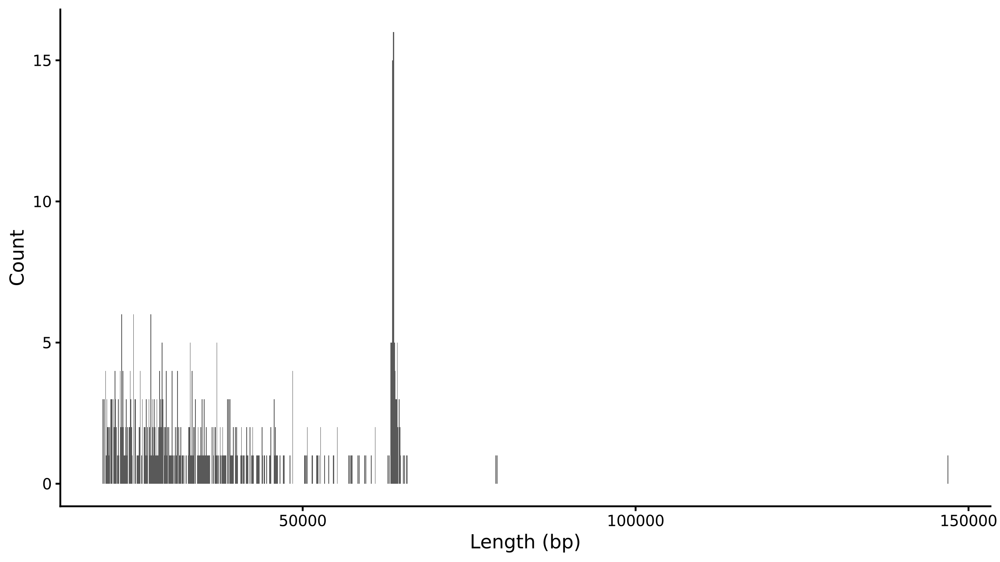
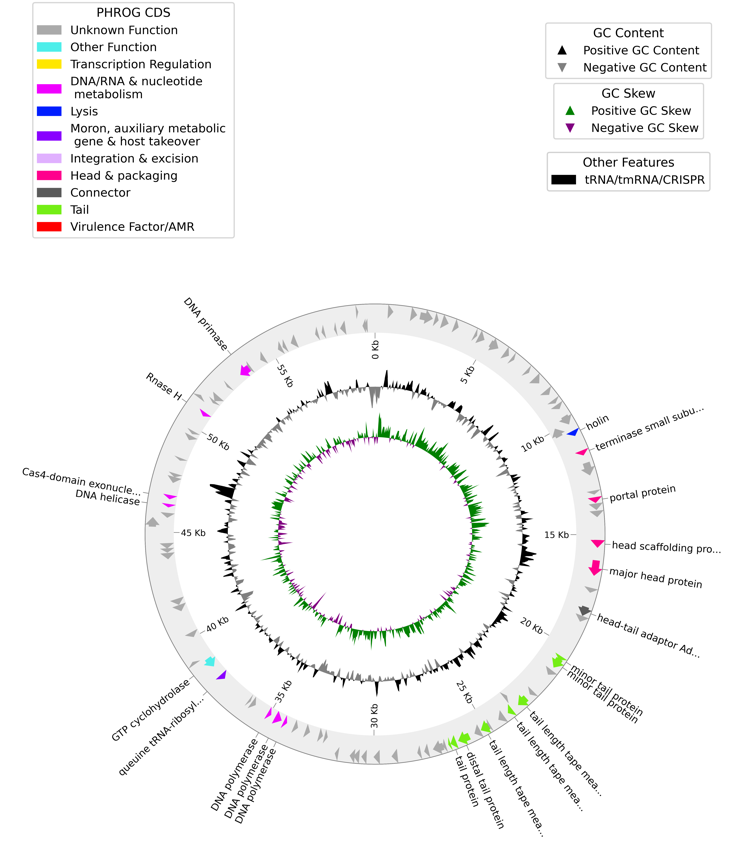
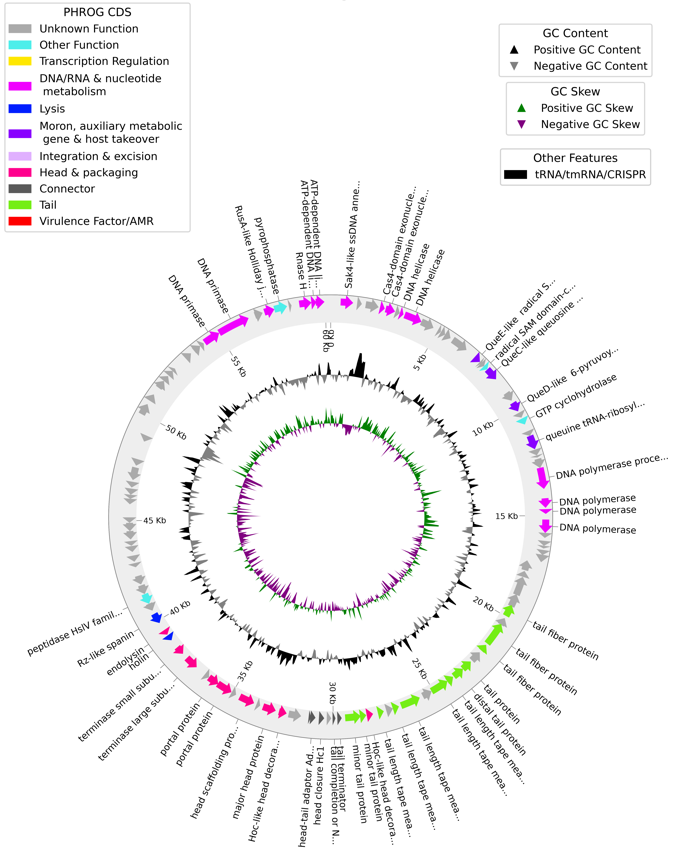

# ALP Snakemake workflow for phage genome characterization

PhageID assembles phage isolates from Oxford Nanopore long reads or TruSeq single-end short reads, selects viral contigs, assesses their quality and annotates them. Viral contigs are then dereplicated.

## Inputs and running

`data/samples.tsv` is tab-separated **without a header**, with columns in this order:

| Sample | Long reads | TruSeq single-end reads | Bacterial host genome |
| --- | --- | --- | --- |
| isolate_long | /path/to/long_reads/ | NA | /path/to/host.fasta |
| isolate_short | NA | /path/to/single_end.fastq.gz | NA |

Each read input can be a file or a directory. At least one read input is required. Paths in the sample sheet may be absolute or relative to `sample_data_root` in `config/config.yaml`. If a bacterial host genome is provided, it will be used to remove bacterial contamination from the sequencing reads.

`data/samples.example.tsv` shows the required layout. Replace its example paths with your own files under `sample_data_root`, then set `samples_file` to the example sheet or your own sheet. The included `data/samples.tsv` records the 67 study samples using paths relative to the original ALP collection. Study reads and host reference FASTAs are available under [NCBI BioProject PRJNA1423127](https://www.ncbi.nlm.nih.gov/bioproject/PRJNA1423127); download and arrange them to match the sample sheet before reproducing the study run. These files are not included in this repository.

Set `samples_file`, `sample_data_root`, `results_dir`, and the reference database paths in `config/config.yaml`. The included study sample sheet uses paths relative to `sample_data_root`. Run from `workflow/` using the Snakemake environment defined in `envs/requirements.yaml`:

Before scheduling jobs for the entry targets below, the workflow checks every configured sample read path and host reference, plus the databases required by the requested target. The assembly target checks geNomad and CheckV, and also Plassembler when any sample has long reads. The default and per-sample targets additionally check Pharokka, Phold, and CheckAMG; the comparison target additionally checks vConTACT3. It reports all missing inputs together. For directory read inputs, it also checks for FASTQ files.

```bash
cd workflow
snakemake --use-conda --cores 8 corrected_assembly_all_phages  # assembly and reports
snakemake --use-conda --cores 8 pipeline_all_phages            # add sample annotation (default target)
snakemake --use-conda --cores 8 pipeline_comparison_phages     # add cross-sample comparisons
```

## Assembly

1. **Preprocess reads.** Combine FASTQ inputs, then trim long reads with Porechop or process short reads with fastp. If a bacterial host genome is supplied, remove host-mapping reads from either read type. The `assembly_read_status` checkpoint records read counts and the percentage removed.
2. **Assemble.** Start with bacterial-free reads when available; otherwise use all preprocessed reads. Long-read samples use Flye after subsampling to approximately 1,000× (hypothesizing a 100 kbp assembly). Short-read-only samples use SPAdes (--isolate, single-end input). When both read columns are provided, the long-read route is used.
3. **Assess each candidate.** Run geNomad, retain viral sequences of at least 2 kbp, prefix contig IDs with the sample name, correct likely concatemers and terminal repeats, then run CheckV. The `candidate_viral_quality` checkpoint makes these results available for assembly selection.
4. **Rescue with autocycler.** If Flye produces no `Complete` or `High-quality` viral contig, run Autocycler on the same read set. By default, four subsets are assembled independently with eight assemblers: Canu, Flye, metaMDBG, miniasm/Minipolish, NECAT, NextDenovo/NextPolish, Plassembler, and Raven. Autocycler then builds a consensus from successful assemblies.
5. **Rescue with all reads.** If the filtered route yields no  `Complete` or `High-quality` viral contigs, repeat steps 2-4 with all reads (including bacterial reads) to allow host-matching prophage recovery. 
6. **Selection policy.** The assembly kept at the end is the one containing the highest CheckV quality viral contigs. Ties prefer filtered reads over all reads, then Flye over Autocycler.
7. **Viral contig correction.** Concatemers and terminal repeats are corrected so that only one viral copy and one terminal repeat remain. The pipeline uses self-BLASTn matches to identify contigs containing multiple complete copies of the same viral sequence. It trims a concatemer to one copy when the matches cover at least 90% of the contig and each copy matches the first at ≥95% identity. It then checks for direct repeats at the ends of the resulting sequence. If a repeat reaches within 20 bp of both ends and has ≥95% identity, the pipeline removes one copy of the longest qualifying repeat.
8. **Report and gate downstream work.** Map all reads and bacterial-free reads onto the selected corrected viral contigs using theBIGbam `--circular`. Write per-sample contig and summary tables. The `viral_report_global` checkpoint concatenates them and allows only samples with retained viral contigs to enter annotation and comparison.

For more details regarding the assembly and selection process, see the [assembly documentation](docs/assembly.md).

## After assembly

Selected contigs receive Pharokka, Phold, Empathi, Sublyme, DefenseFinder and CheckAMG annotations with prodigal-gv gene predictions. Functional predictions are all combined in a GFF for theBIGbam.
Alternative Genotate gene calls with Pharokka protein annotation is also run to find potential overlapping genes. PhageTerm analysis is also run on the viral contigs.

All-versus-all ANI allows to dereplicate contigs at ≥95% ANI and ≥85% aligned fraction (of the member contig, with no minimum representative aligned fraction). Representatives are considered by CheckV quality category, then by `completeness − 5 × contamination + 0.5 × log10(corrected length)` within a category. It produces a dereplication report, LoVis4u comparisons and vConTACT3 clustering with prokaryotic reference genomes.

A theBIGbam database with all viral contigs and all samples using MAG view: one sample contains all its selected viral contigs, with two BAMs per sample (all reads and bacterial-free reads). 
A second database is made with only representative viral contigs and all samples, using contig view. The `prepare_post_dereplication_mapping` checkpoint resolves sample–representative pairs after clustering.

## Main reports

- `<sample>/assembly_stats.tsv`: one row per selected viral contig, with assembler, assembly read set, preprocessing read counts, host-mapping percentage, original and corrected lengths, both coverage values, Flye circularity, automatic correction counts, manual edit status and length change, CheckV metrics and geNomad taxonomy/provirus status. `<sample>/viral_sample_report.tsv`: one sample summary row. Global tables are `reports/assembly_report_per_viral_contig.tsv` and `reports/assembly_report_per_sample.tsv`.
- `reports/annotation_report_per_viral_contig.tsv`: one row per selected viral contig, with Pharokka function counts and `Coding_density_percent` (the percentage of corrected contig bases covered by at least one Pharokka CDS). Per-sample tables are `<sample>/pharokka/viral_annotations_report.tsv`.
- `reports/dereplication_report.tsv`: every contig before dereplication, its selection status, representative, lengths, cluster size, ANI and aligned fractions.

## How can I assess the completeness of my viral contigs?

CheckV assessment alone may not be sufficient to establish viral genome completeness. Throughout this project, several contigs classified as high-quality by CheckV were subsequently found to be too short, too long, or to contain substantial assembly errors. To address these limitations, the pipeline provides several complementary metrics to support genome quality assessment. We therefore recommend that users manually examine these metrics rather than relying solely on CheckV classifications to determine whether their assembled viral genomes are complete and accurately assembled.

### Size of viral reads

For every long-read sample, the assembly and default targets require a histogram of read lengths above 20 kbp classified as viral by geNomad. Producing it requires the configured geNomad database and the R/ggplot2 environment. Short-read-only samples have no histogram. When no reads meet the threshold or none is classified as viral, the required output is a labeled empty plot.

For a long-read sample with sufficiently long molecules, a peak may suggest the expected viral genome length. For example, the Rahnella311_T5_7_A1_200826 histogram (`reports/viral_long_reads_histograms/Rahnella311_T5_7_A1_200826_viral_long_reads_histogram.png`) has a peak near 63 kbp:
<p align="center">
  
</p>
A viral contig different than this size usually indicates a bad assembly. In particular, a contig whose length is an integer multiple of the expected size may represent a concatemer that requires correction to retain a single copy of the viral genome.

### Read mapping

The columns %_mapped and %_mapped_without_bacteria `reports/assembly_report_per_viral_contig.tsv` indicate the percentage of reads from each sample that map to its assembled viral contigs. For a pure phage culture, more than 90% of reads are expected to map to the corresponding viral contig, particularly when considering %_mapped_without_bacteria, which excludes contaminating reads mapping to the bacterial host genome.

### Circularisation

If your viral contig was assembled by Flye, the column Flye_circularity in `reports/assembly_report_per_viral_contig.tsv` lets you know whether the contig was circular during the assembly (value Y).

Alternatively, theBIGbam database per sample available in `thebigbam` directory allows to assess the circularity (and thus the completeness) of your viral contig. You can serve the database with `thebigbam serve --db <database>` command, select your contig and sample of interest, click APPLY and then SHOW SUMMARY on the top right. The Topology category gives you the number of circularising reads and the prevalence of those reads among the reads mapping at the end of your viral contig. If you do not see a Topology category, you need to switch from "MAG VIEW" to "CONTIG VIEW" before clicking APPLY.

### Coding density

Another useful metric is the coding density given in `reports/annotation_report_per_viral_contig.tsv`. A low coding density (below 80%) is usually a sign of a poor assembly. In certain cases, with long reads, we observe viral contigs with the expected length but full of assembly errors resulting in a low coding density. For example, for Rahnella311_T5_7, a first sequencing resulted in a very low coding density. That results in a sparse gene map:
<p align="center">
  
</p>

After resequencing and reassembly, a viral contig of a similar length is obtained but with a better contig density (>90%). This is also visually way more pleasing:
<p align="center">
  
</p>

## Key resources table

### Software and algorithms

Versions below describe the direct package constraints in `envs/` and the explicit install commands in the workflow. They are not a complete lock of Conda, pip, or downloaded model dependencies.

| REAGENT or RESOURCE | SOURCE | IDENTIFIER |
| --- | --- | --- |
| Snakemake | [Snakemake](https://snakemake.github.io/) | v7.32.4 |
| Mamba | [mamba-org](https://mamba.readthedocs.io/) | v1.5.6 |
| Python | [Python Software Foundation](https://www.python.org/) | v3.10.13 (workflow); v3.8.10 (Genotate); v3.9 (PhageTerm); v3.11.5 (Empathi and Sublyme); v3.11 (CheckAMG) |
| Porechop | [Wick; Porechop](https://github.com/rrwick/Porechop) | v0.2.4 |
| fastp | [fastp](https://github.com/OpenGene/fastp) | v0.23.4; single-end TruSeq preprocessing |
| Seqtk | [Li; seqtk](https://github.com/lh3/seqtk) | v1.5 |
| Autocycler | [Autocycler](https://github.com/rrwick/Autocycler) | v0.7.0; automatic long-read fallback |
| miniasm and Minipolish | [miniasm](https://github.com/lh3/miniasm); [Minipolish](https://github.com/rrwick/Minipolish) | miniasm v0.3; Minipolish v0.2.1 |
| Racon | [Racon](https://github.com/lbcb-sci/racon) | v1.5.0 |
| Canu | [Canu](https://github.com/marbl/canu) | v2.3 |
| metaMDBG | [metaMDBG](https://github.com/GaetanBenoitDev/metaMDBG) | v1.4 |
| NECAT | [NECAT](https://github.com/xiaochuanle/NECAT) | v0.0.1_update20200803 |
| NextDenovo | [NextDenovo](https://github.com/Nextomics/NextDenovo) | v2.5.2 |
| NextPolish | [NextPolish](https://github.com/Nextomics/NextPolish) | v1.4.1; polishing for the NextDenovo candidate |
| Plassembler | [Plassembler](https://github.com/gbouras13/plassembler) | v1.8.5 |
| Raven | [Raven](https://github.com/lbcb-sci/raven) | v1.8.3 (Autocycler candidate assemblies) |
| Flye | [Flye](https://github.com/mikolmogorov/Flye) | v2.9.6 |
| SPAdes | [SPAdes](https://github.com/ablab/spades) | v4.3.0 |
| geNomad | [Camargo et al.; geNomad](https://github.com/apcamargo/genomad) | v1.12.0 |
| CheckV | [CheckV](https://pypi.org/project/checkv/) | v1.1.1 |
| PhageTermVirome | [PhageTermVirome](https://pypi.org/project/phagetermvirome/4.3/) | v4.3 |
| Pharokka | [Bouras et al.; Pharokka](https://github.com/gbouras13/pharokka) | v1.10.1 |
| Phold | [Bouras et al.; Phold](https://github.com/gbouras13/phold) | v1.3.0 |
| Genotate | [Genotate](https://github.com/deprekate/genotate) | v0.15 |
| Empathi | [Boulay; Empathi](https://huggingface.co/AlexandreBoulay/empathi) | Git revision `7e9cccc00b29e11db1c0bfa066167e8026ef981c` |
| Sublyme | [Rousseau Team; Sublyme](https://github.com/Rousseau-Team/sublyme) | v1.2.2 |
| DefenseFinder | [DefenseFinder](https://github.com/mdmparis/defense-finder) | v3.0.0 (`mdmparis-defense-finder`) |
| MacSyFinder | [MacSyFinder](https://macsyfinder.readthedocs.io/) | v2.1.4 |
| HMMER | [HMMER](http://hmmer.org/) | v3.4 (DefenseFinder environment) |
| CheckAMG | [Anantharaman Lab; CheckAMG](https://github.com/AnantharamanLab/CheckAMG) | Git revision `d29aaef` |
| LoVis4u | [Egorov et al.; LoVis4u](https://github.com/art-egorov/lovis4u) | v0.1.5 |
| pyhmmer | [pyhmmer](https://github.com/althonos/pyhmmer) | v0.11.4 (LoVis4u environment) |
| vConTACT3 | [vConTACT3](https://vcontact3.readthedocs.io/) | v3.1.6 |
| theBIGbam | [theBIGbam](https://github.com/bhagavadgitadu22/theBIGbam) | v0.8.0 |
| Minimap2 | [Li; minimap2](https://github.com/lh3/minimap2) | v2.31 (Autocycler); otherwise unpinned; used for read mapping |
| SAMtools | [SAMtools](https://www.htslib.org/) | Unpinned; used for alignment processing |
| BLAST+ (BLASTn) | [NCBI BLAST](https://blast.ncbi.nlm.nih.gov/Blast.cgi) | Unpinned; used for self-alignment and genome comparisons |
| Biopython | [Biopython](https://biopython.org/) | v1.80 (Pharokka environment) |
| TensorFlow | [TensorFlow](https://www.tensorflow.org/) | v2.13.1 (Genotate) |
| PyTorch | [PyTorch](https://pytorch.org/) | Version unpinned in the Phold environment; v2.7.1, CUDA 12.8 wheels (Empathi); v2.8.0, CPU wheels (CheckAMG) |
| NumPy | [NumPy](https://numpy.org/) | <2.0 in the PhageTerm environment; exact version unpinned |
| Matplotlib | [Matplotlib](https://matplotlib.org/) | Unpinned; used by custom plotting scripts |
| pyCirclize | [pyCirclize](https://github.com/moshi4/pyCirclize) | Unpinned; used for Genotate contig plots |
| R and ggplot2 | [R](https://www.r-project.org/); [ggplot2](https://ggplot2.tidyverse.org/) | Unpinned in the viral-read histogram environment |
| GNU Scientific Library | [GNU GSL](https://www.gnu.org/software/gsl/) | v2.7.0 (Pharokka environment) |
| Poetry | [Poetry](https://python-poetry.org/) | v1.8.5 (PhageTerm installation) |

### Deposited data and reference databases

| REAGENT or RESOURCE | SOURCE | IDENTIFIER |
| --- | --- | --- |
| Short-read sequencing data | [NCBI BioProject PRJNA1423127](https://www.ncbi.nlm.nih.gov/bioproject/PRJNA1423127) | Optional third (TruSeq) column in `data/samples.tsv` |
| Long-read sequencing data | [NCBI BioProject PRJNA1423127](https://www.ncbi.nlm.nih.gov/bioproject/PRJNA1423127) | Per-sample read files or directories specified in `data/samples.tsv` |
| Host reference genomes | [NCBI BioProject PRJNA1423127](https://www.ncbi.nlm.nih.gov/bioproject/PRJNA1423127) | Optional host genome FASTA paths specified in `data/samples.tsv` |
| geNomad database | [geNomad database](https://portal.nersc.gov/genomad/) | v1.9 |
| CheckV database | [CheckV database](https://portal.nersc.gov/CheckV/) | v1.5 |
| Pharokka database bundle | [Pharokka](https://github.com/gbouras13/pharokka) | v1.8 |
| Phold database bundle | [Phold](https://github.com/gbouras13/phold) | Downloaded in August 2025 |
| Empathi model files | [Empathi](https://huggingface.co/AlexandreBoulay/empathi) | Git LFS files retrieved at revision `7e9cccc00b29e11db1c0bfa066167e8026ef981c` |
| Sublyme model files | [Rousseau Team; Sublyme](https://github.com/Rousseau-Team/sublyme) | Downloaded with v1.2.2 of the tool |
| DefenseFinder models | [DefenseFinder models](https://github.com/mdmparis/defense-finder-models) | Downloaded with `defense-finder update`; model release unpinned |
| CheckAMG annotation database | [CheckAMG](https://github.com/AnantharamanLab/CheckAMG) | v1.1 |
| vConTACT3 reference database | [vConTACT3 databases](https://vcontact3.readthedocs.io/en/latest/databases.html) | v230 |
| LoVis4u HMM profiles | [LoVis4u](https://github.com/art-egorov/lovis4u) | Downloaded with `lovis4u --get-hmms`; profile release unpinned |

## Citing the pipeline

If you use this workflow in your research, please cite this paper:
> Wai Hoe Chin, Martin Boutroux, Akira Harding, Davide Demurtas, Florian Baier, Hannes Peter (2026). Viral isolation reveals novel and diverse phages infecting natural stream biofilms. bioRxiv 2026.03.26.713887. https://doi.org/10.64898/2026.03.26.713887
